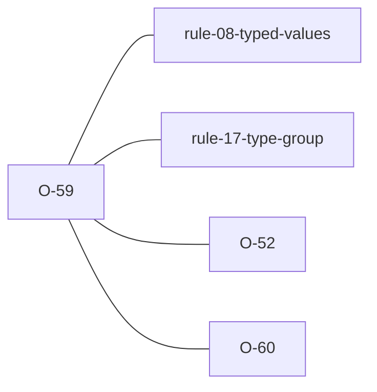

# O-59 — declared TYPE differs from the dictionary (or the file's own DICT) → FYI (Related to Rule 8), WARNING on a join key

> Source-of-truth is `repo:observations.json` (record O-59), rendered to
> `repo:OBSERVATIONS.md#o-59` — never hand-edit the Markdown.
> This page links + cross-references only — it never copies the 5 fields.

## Summary
> [!variance] **VARIANCE — laterite-originated, no python-ags4 equivalent.** A file may declare a standard heading with a data type other than its edition's dictionary type (`LNMC_MC` as `1DP` where 4.1.1 says `X`). Rule 8 reads the file's own TYPE row, so nothing fails until the file is combined with one typed the dictionary's way. With FYIs on, laterite names each such heading once, with the edition and the dictionary's type. Since 2026-10-09 a **KEY** heading's departure is a **WARNING** instead, shown by default: a KEY column typed its own way is where a child's TYPE row comes to differ from its parent's, and python-ags4's Rule 10c then rejects that child on its TYPE line ([[O-52]]) — a delivery laterite had passed, with the cause behind `--show-fyi`. Since #1209 a heading the edition does not define for its group, but the file's own DICT declares with a type, is compared with that DICT row instead, on the same tiers, and the message names the DICT; a standard heading is still judged against the edition only, so a DICT row restating one is [[O-60]]'s, never a second finding here. Since 2026-11-16 the warning goes to a **join key** only: a heading KEY in its group and in at least one other group of the dictionary in effect (the edition, plus the file's own DICT where the edition defines nothing). KEY means the status contains KEY, so `KEY+REQUIRED` counts, as the spec's status column and python-ags4's Rules 10a/10c read it. A KEY no other group keys on (`PROJ_ID`, `CORE_TOP`, a user group's own key) has no parent or child copy to disagree with, so it is the FYI. Neither tier changes the verdict.

Source-of-truth (never pasted): `repo:observations.json`, record O-59 — rendered at `repo:OBSERVATIONS.md#o-59`.

## Rules affected
- [[rule-08-typed-values]] — the check is `declared_type` in `repo:rust-packages/laterite-ags4-validator/src/rules/typed_values.rs`, run beside Rule 8 rather than inside it; it reads the file's DICT through the effective dictionary's `FileDict`. Rule 8 still judges values against the declared type.
- [[rule-17-type-group]] — still requires only that every code used is defined. No rule requires the declared type to equal the dictionary's; this FYI reports the difference without making it one.

## Cross-observation graph

- [[dec-ags4-merge-semantics]] — merge's `on_type_clash` settles clashes between the TYPE rows the inputs declare and never compares them with the dictionary; this FYI is the per-file view of what such a clash will be.
- [[O-60]] — names a DICT row that restates a standard heading; this record compares a TYPE row with a DICT row only where the edition defines nothing, so the two never report the same row twice.
- [[parity-model]] — the label is rust-only by construction, and `classify` in `repo:rust-packages/laterite-ags4-parity/src/verdict.rs` reconciles it to this record.

## Surfaces
Native surfaces only, by owner decision on #1013: `laterite.validate()`, `lat`, Node and wasm emit it, and `check_file` in `repo:packages/laterite/python/laterite/compat/_impl.py` withholds both labels — the FYI and the join key's warning — while every other FYI and warning passes through. In the drop-in it would be noise python-ags4 users never asked for, and it trips one of python-ags4's own tests, so the parity known-failures set stays as it was.

## Upstream status
> [!note] Upstream-reportable: **[NO]** — an additive laterite advisory, not a python-ags4 defect or a spec ambiguity.

## Related
[[rule-08-typed-values]] · [[rule-17-type-group]] · [[dec-ags4-merge-semantics]] · [[parity-model]] · [[O-52]] · [[O-60]]
