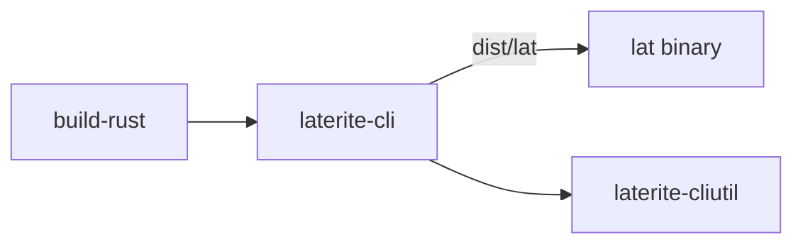

# build-rust

## What it is
> [!quote] Builds the `lat` AGS4 CLI ([[laterite-cli]]) in release mode with
> `cargo build --release -p laterite-cli` and copies the binary into `dist/`.
> `.ps1` (Windows) + `.sh` (macOS/Linux) siblings.

It is for a local build of the CLI on its own. Releases do not use it: the
release workflow builds `lat` per platform from the `v*` tag.

## Inputs / outputs
> [!quote] In: the Rust workspace + a `cargo`/`rustup` toolchain. Out:
> `dist/lat` (`dist\lat.exe` on Windows; `dist/` gitignored), with the cargo
> cache in `rust-packages/target/release/`. The CLI is DuckDB-free, so no
> bundled database engine is compiled; each script prints the binary's size
> when it finishes.

## Where it lives
`repo:tools/build-rust.ps1` (+ `repo:tools/build-rust.sh`)

## Relationship to other components

`lat` is one of three programs answering to that name (the Rust binary, the
wheel's console script and the Node launcher); this script builds the first.
The Python `laterite` wheel is the primary library surface, and Rust drives
Python rather than the reverse: see [[dec-rust-drives-python]]. See
[[crate-map]] for the workspace dependency graph.

## Related
[[laterite-cli]] · [[laterite-cliutil]] · [[dec-rust-drives-python]] · [[crate-map]]
