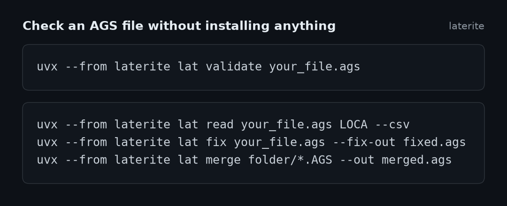

# Post 0, the opener: LinkedIn



---

"First, install Python" is where a lot of people stop reading.

You can check an AGS file with one line and nothing installed:

```
uvx --from laterite lat validate your_file.ags
```

`uvx` fetches the tool, runs it, and leaves your machine as it found it.

The same shape reads a group out as CSV, applies the safe fixes, or merges a folder of files:

```
uvx --from laterite lat read your_file.ags LOCA --csv
uvx --from laterite lat fix your_file.ags --fix-out fixed.ags
uvx --from laterite lat merge folder/*.AGS --out merged.ags
```

It exits with an error when it finds a problem, so it can stop a bad file going out.

This week I am posting one thing a day you can do with AGS data in Python. This is where to start: [link]

#AGS4 #geotechnics #python
