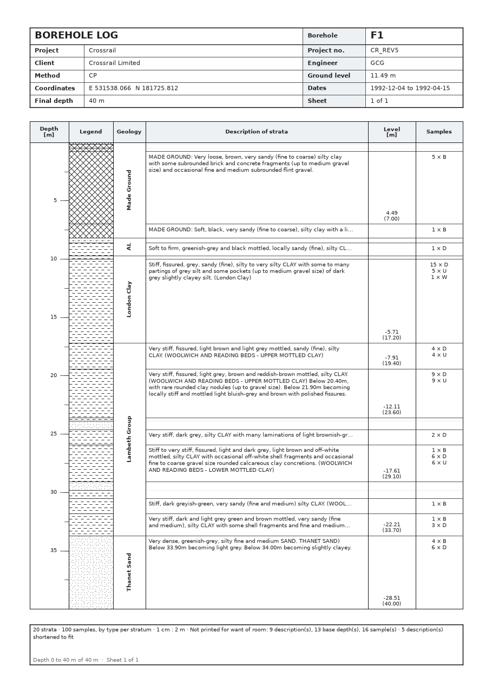

# One line gets you a whole borehole

_Post 1 of 5. Script: `one_borehole.py`, beside this draft._



An AGS4 file is a stack of tables. A borehole's story is spread across them:
where it is (`LOCA`), what it went through (`GEOL`), what was taken from it
(`SAMP`), what was tested in it (`ISPT`), and on through the lab groups. The
tables are tied together by a key, `LOCA_ID`, that every one of them repeats.

So the question "give me borehole F1" usually becomes a loop: for each group,
check it has a `LOCA_ID` column, filter it, keep the result. It is not hard.
It is the same dozen lines in every script anyone has written against AGS.

laterite does it for you:

```python
import laterite

ags = laterite.read("your_file.ags")
record = ags.at("LOCA", ["F1"])
```

Nothing has been read yet. `record` is a query, and it can tell you what it
will return before you ask for it:

```python
print(record.groups)
# ['LOCA', 'GEOL', 'BKFL', 'CDIA', 'WSTG', 'WSTD', 'ISPT', 'SAMP']
```

Those are the groups in this file that carry `LOCA_ID`. laterite worked that
out from the file, so it is right for your file too, whatever groups it has.
Then:

```python
frames = record.frames()
for code, frame in frames.items():
    print(f"{code}  {frame.height:>4} rows")
```

```
LOCA     1 rows
GEOL    20 rows
BKFL     0 rows
CDIA     0 rows
WSTG     0 rows
WSTD     0 rows
ISPT    20 rows
SAMP   100 rows
```

The file here is a BGS export of twelve Crossrail boreholes at Farringdon.
F1 is a 40 m cable percussion hole with 20 strata, 20 SPTs and 100 samples.
Groups with no rows for this hole come back empty rather than missing, so
code that expects `frames["WSTG"]` does not fall over.

Each frame is an ordinary polars frame. Sort it, filter it, plot it:

```python
strata = frames["GEOL"].sort("GEOL_TOP")
print(strata.select("GEOL_TOP", "GEOL_BASE", "GEOL_DESC"))
```

```
┌──────────┬───────────┬─────────────────────────────────┐
│ GEOL_TOP ┆ GEOL_BASE ┆ GEOL_DESC                       │
│ f64      ┆ f64       ┆ str                             │
╞══════════╪═══════════╪═════════════════════════════════╡
│ 0.0      ┆ 0.13      ┆ MADE GROUND: Tarmacadam.        │
│ 0.13     ┆ 0.46      ┆ MADE GROUND: Concrete.          │
│ …        ┆ …         ┆ …                               │
│ 31.8     ┆ 33.7      ┆ Very stiff, dark and light gre… │
│ 33.7     ┆ 40.0      ┆ Very dense, greenish-grey, sil… │
└──────────┴───────────┴─────────────────────────────────┘
```

Want three holes? Pass three IDs.

## Two things to watch for

**The project is not in the record set.** `PROJ` has no `LOCA_ID`, so the
fan-out leaves it out. If you are building a log header, add it yourself:

```python
frames["PROJ"] = ags["PROJ"]
```

**A hole that is not in the file gives you empty frames, quietly.** Ask for
`"F01"` when the file says `"F1"` and you get eight frames with no rows and
no complaint. Until laterite warns about this itself (it is on the list),
check first:

```python
holes = ags["LOCA"]["LOCA_ID"].to_list()
if hole not in holes:
    sys.exit(f"{hole} is not in this file. It holds: {', '.join(holes)}")
```

## It is a fan-out, not a join

You get one frame per group, each still keyed on its own columns. Nothing has
been joined to anything. That is the right shape for a log or an export. When
you want samples matched to the stratum they came from, you want a join, and
that is post 3.

## The figure

The log at the top is drawn from `frames` with
[laterite-outcrop](https://github.com/niko86/laterite-outcrop), a small
plotting library I am building alongside this series
(`pip install "laterite-outcrop[laterite]"`):

```python
from outcrop import ags as plots

plots.borehole_log("your_file.ags", "F1").savefig("F1.pdf")
```

The Geology column brackets the strata that share a unit and names it once.
This file gives its units as codes (`LC`, `TS`) and never spells them out, so
the figure passes the names in: `unit_names={"LC": "London Clay", ...}`.

## No file to hand?

Everything above runs on your own AGS4 file. If you want the one used here,
[laterite-quarry](https://github.com/niko86/laterite-quarry) is a small
command-line tool that fetches public AGS data politely:

```
uvx --from laterite-quarry quarry bgs pull farringdon --bbox -0.108,51.518,-0.102,51.522
```

The pull arrives in three pieces. The file used here is the first,
`bgs/farringdon/cell000/202002061142130.ags`.

_Contains British Geological Survey materials ©NERC 2026. Run on laterite 0.17.1._
