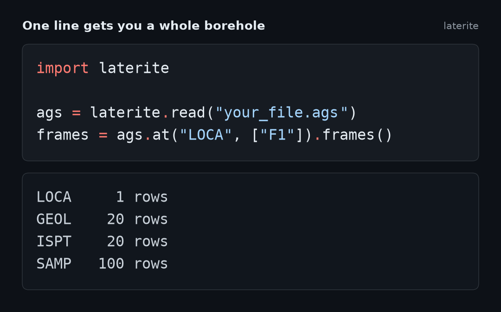
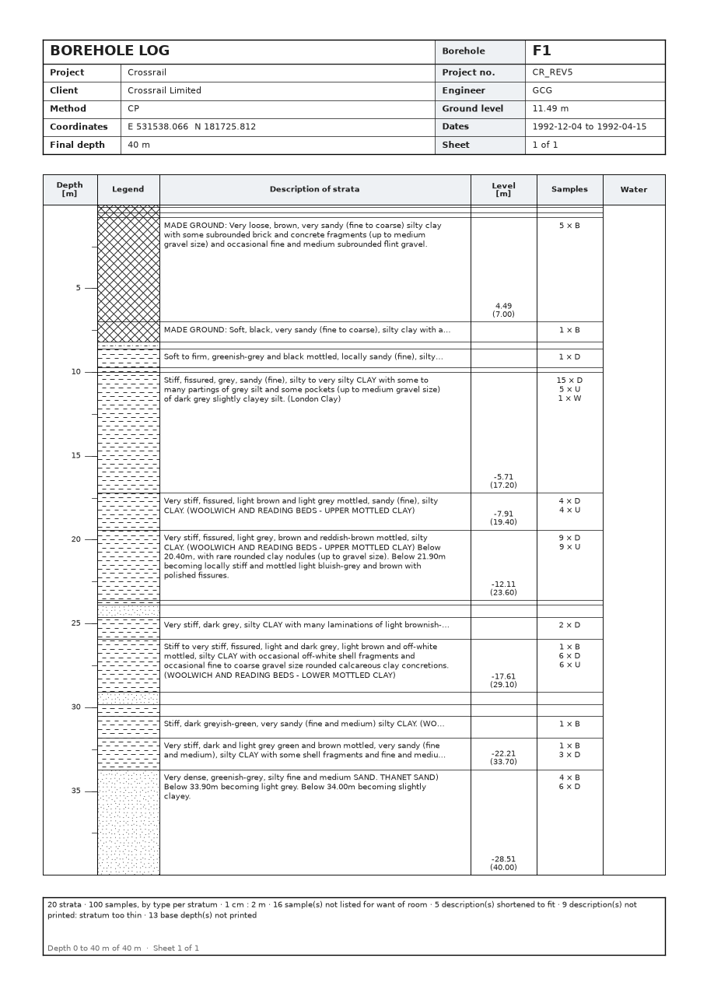

# Post 1: LinkedIn





---

Someone sends you an AGS file with a dozen boreholes in it. You want one: its strata, its samples, its SPTs.

In laterite that is one line.

```python
import laterite

ags = laterite.read("your_file.ags")
frames = ags.at("LOCA", ["F1"]).frames()
```

```
LOCA     1 rows
GEOL    20 rows
ISPT    20 rows
SAMP   100 rows
```

No loop over groups, no filter written eight times. laterite works out which groups hang off the hole from the file itself.

The log is borehole F1 from Crossrail's Farringdon investigation, drawn from those frames.

The full script, and two things to watch for: [link]

Contains British Geological Survey materials ©NERC 2026.

#AGS4 #geotechnics #python
