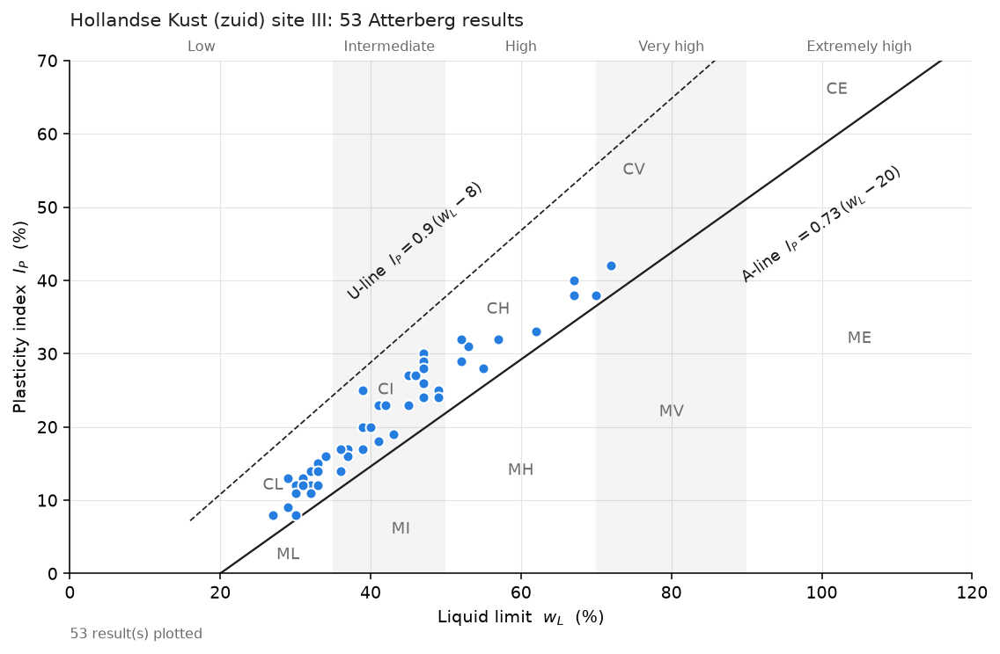

# Your depths are already numbers

_Post 2 of 5. Script: `typed_columns.py`, beside this draft._



Under every heading in an AGS4 file sit two more rows: its unit and its type.

```
"HEADING","LOCA_ID","SAMP_TOP","LLPL_LL","LLPL_PL","LLPL_PI"
"UNIT","","m","%","%","%"
"TYPE","ID","2DP","1DP","1DP","1DP"
```

`2DP` is a number to two decimal places. `DT` is a date. `X` is free text.
The file is telling you its own schema. A reader that hands every column back
as a string has thrown that away, and you write it back in by hand: cast this,
parse that, hope the blank cells do not break it.

laterite reads the TYPE row and builds each column accordingly. Here is what
the file declares, beside what you get:

```python
import laterite

ags = laterite.read("your_file.ags")
limits = ags["LLPL"]

for heading, declared in zip(ags.headings("LLPL"), ags.types("LLPL"), strict=True):
    print(f"{heading:<10} {declared:<4} {limits.schema[heading]}")
```

```
LOCA_ID    ID   String
SAMP_TOP   2DP  Float64
SAMP_REF   X    String
SAMP_TYPE  PA   String
SAMP_ID    ID   String
SPEC_REF   X    String
SPEC_DPTH  2DP  Float64
LLPL_LL    1DP  Float64
LLPL_PL    1DP  Float64
LLPL_PI    1DP  Float64
LLPL_425   1DP  Float64
LLPL_LAB   X    String
```

The same goes for the other types: `0DP` becomes an integer, `DT` a datetime.
A blank cell is a null, not an empty string.

So arithmetic and comparisons mean what they say from the first line:

```python
import polars as pl

print(limits.select(pl.col("LLPL_LL").mean().round(1), pl.col("LLPL_PI").max()))
# mean liquid limit 41.6, highest plasticity index 42.0

high = limits.filter(pl.col("LLPL_LL") >= 50)
print(f"{high.height} of {limits.height} results are high plasticity or above")
# 10 of 53 results are high plasticity or above
```

The data is Fugro's borehole campaign for site III of the Hollandse Kust
(zuid) offshore wind farm, published by the Netherlands Enterprise Agency:
seventeen boreholes, 53 Atterberg results. (It arrives as seventeen files.
Post 5 merges them.)

## The catch: typed as the file declares

laterite does not guess. A column is typed as its TYPE row says, and if the
file says text, you get text.

The same Fugro files declare natural water content as `X`:

```python
declared = dict(zip(ags.headings("LNMC"), ags.types("LNMC"), strict=True))
print(declared["LNMC_MC"], ags["LNMC"].schema["LNMC_MC"])
# X String
```

That is the file's choice, and laterite keeps it. Casting is then your
decision, made where you can see it:

```python
water = ags["LNMC"].with_columns(pl.col("LNMC_MC").cast(pl.Float64, strict=False))
```

Some files go further. The BGS export used in posts 1 and 4 declares most
columns `X`, so its sample depths come back as text. For a file like that the
headline of this post is not true, and it is better to find out in one line
than in a plot that sorts 10 before 9:

```python
print(dict(zip(ags.headings("SAMP"), ags.types("SAMP"), strict=True)))
```

One more door: columns declared `XN` (a number that may carry text, like
`<0.01`) stay text by default, and `laterite.read(path, xn="numeric")` reads
them as numbers.

## The figure

The plasticity chart is one line with
[laterite-outcrop](https://github.com/niko86/laterite-outcrop):

```python
from outcrop import ags as plots

plots.plasticity_chart("your_file.ags")
```

## No file to hand?

[laterite-quarry](https://github.com/niko86/laterite-quarry) fetches the
files used here:

```
uvx --from "laterite-quarry[rvo]" quarry rvo pull hkz-wfs3-bh
```

_Data: Netherlands Enterprise Agency (RVO) / Fugro. Run on laterite 0.17.1._
