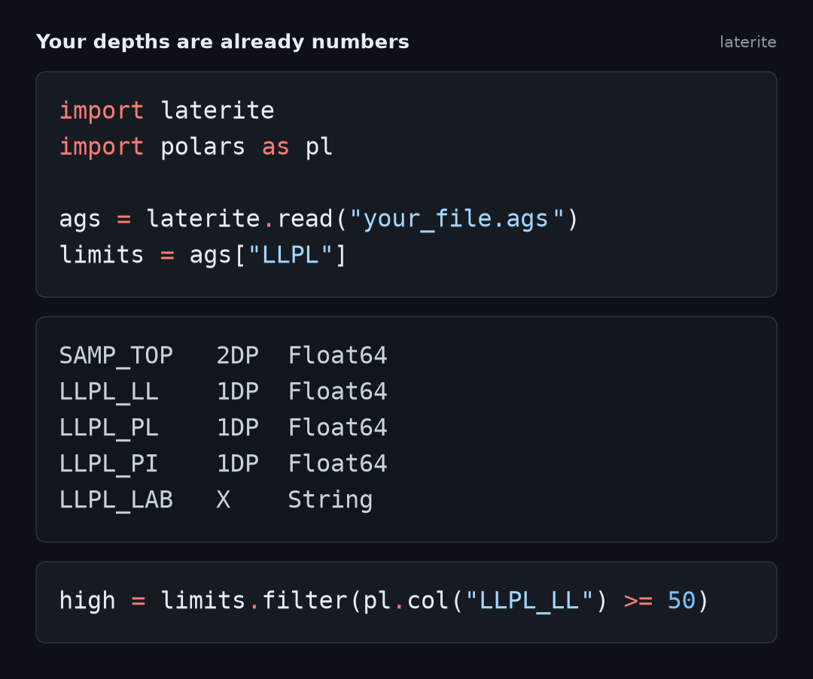
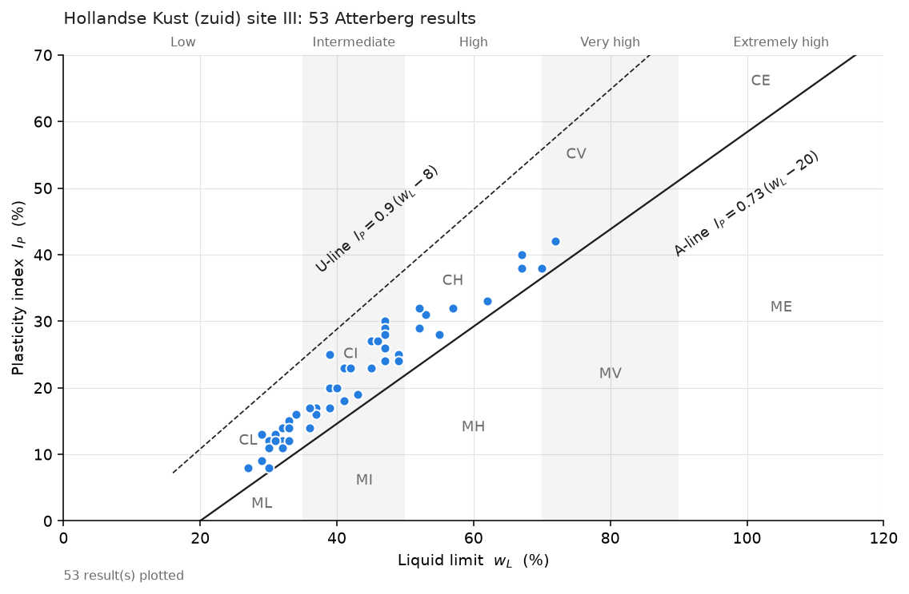

# Post 2: LinkedIn





---

Every AGS file says what type each column is. Most tools read it all as text anyway, and you start every script turning "12.50" back into 12.5.

laterite reads the TYPE row and gives you columns already typed that way.

```python
import laterite
import polars as pl

ags = laterite.read("your_file.ags")
limits = ags["LLPL"]
```

What the file declares, and what you get:

```
SAMP_TOP   2DP  Float64
LLPL_LL    1DP  Float64
LLPL_PL    1DP  Float64
LLPL_PI    1DP  Float64
LLPL_LAB   X    String
```

Depths are floats, dates are datetimes, counts are integers. So this needs no casting:

```python
high = limits.filter(pl.col("LLPL_LL") >= 50)
```

One catch: a column is typed as the file declares it. If the file says text, you get text. How to spot that in one line: [link]

The chart is 53 Atterberg results from Fugro's Hollandse Kust (zuid) boreholes.

Data: Netherlands Enterprise Agency (RVO) / Fugro.

#AGS4 #geotechnics #python
