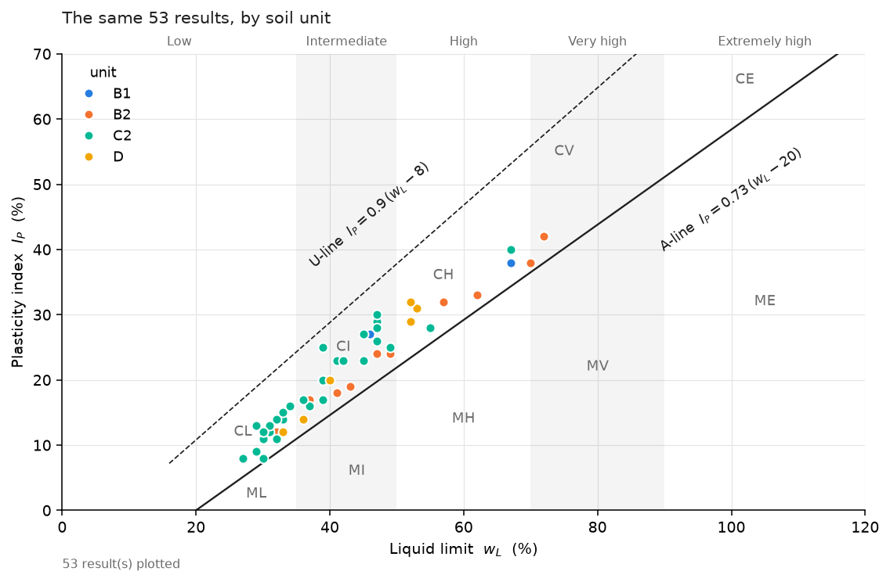

# A fan-out is not a join

_Post 3 of 5. Script: `sql_across_groups.py`, beside this draft._



Post 1 pulled one borehole's groups out as separate frames. That is a
fan-out: each group on its own, cut to the hole you asked for.

Some questions need the groups put together. "What is the plasticity of each
soil unit?" needs the Atterberg results (`LLPL`) matched to the strata
(`GEOL`), and AGS holds no link between them. A lab result records its
borehole and its sample depth. A stratum records its borehole, top and base.
The match is: same hole, and the sample depth falls inside the stratum.

That is a range join, and SQL is the natural way to write it. laterite
exposes every group in the file as a table named by its four-letter code:

```python
import laterite
import polars as pl

ags = laterite.read("your_file.ags")

by_unit = ags.sql("""
    SELECT g.GEOL_STAT              AS unit,
           a.ABBR_DESC              AS soil,
           count(*)                 AS tests,
           round(avg(l.LLPL_LL), 1) AS mean_ll,
           round(avg(l.LLPL_PI), 1) AS mean_pi
    FROM LLPL l
    JOIN GEOL g
      ON g.LOCA_ID   = l.LOCA_ID
     AND l.SAMP_TOP >= g.GEOL_TOP
     AND l.SAMP_TOP <  g.GEOL_BASE
    LEFT JOIN ABBR a
      ON a.ABBR_HDNG = 'GEOL_LEG'
     AND a.ABBR_CODE = g.GEOL_LEG
    GROUP BY ALL
    ORDER BY unit, tests DESC
""")
print(pl.DataFrame(by_unit))
```

Three groups in one statement: the results, the strata they fall in, and the
file's own abbreviation table to turn legend code `201` into `CLAY`.

```
┌──────┬────────────┬───────┬─────────┬─────────┐
│ unit ┆ soil       ┆ tests ┆ mean_ll ┆ mean_pi │
╞══════╪════════════╪═══════╪═════════╪═════════╡
│ B1   ┆ SAND       ┆ 2     ┆ 56.5    ┆ 32.5    │
│ B2   ┆ CLAY       ┆ 8     ┆ 50.1    ┆ 25.5    │
│ B2   ┆ Sandy CLAY ┆ 3     ┆ 36.0    ┆ 16.3    │
│ B2   ┆ SAND       ┆ 1     ┆ 70.0    ┆ 38.0    │
│ C2   ┆ CLAY       ┆ 18    ┆ 39.9    ┆ 20.2    │
│ C2   ┆ Silty SAND ┆ 6     ┆ 37.0    ┆ 17.3    │
│ C2   ┆ SAND       ┆ 4     ┆ 33.0    ┆ 14.8    │
│ C2   ┆ Sandy CLAY ┆ 4     ┆ 32.5    ┆ 13.0    │
│ C2   ┆ null       ┆ 1     ┆ 45.0    ┆ 27.0    │
│ D    ┆ CLAY       ┆ 6     ┆ 44.3    ┆ 23.0    │
└──────┴────────────┴───────┴─────────┴─────────┘
```

The data is the Fugro campaign from post 2. Fugro put its soil unit in
`GEOL_STAT`; your file may use `GEOL_GEOL` or `GEOL_FORM`.

The table earns its keep straight away. Atterberg limits on strata logged as
SAND are worth a second look: clay laminae in a sand, or a sample depth that
sits on a boundary. A fan-out would not have shown that.

There is no database to install or load. The engine is DuckDB, it ships with
laterite, and it reads the same typed columns as post 2, so
`l.SAMP_TOP >= g.GEOL_TOP` compares numbers.

## Three things to watch for

**Getting a frame back.** `.sql()` returns a DuckDB relation. On a plain
`pip install laterite`, turn it into polars with `pl.DataFrame(relation)`.
DuckDB's own `.pl()` and `.df()` need pyarrow and pandas, which laterite does
not install for you.

**A join drops what does not match.** A result whose depth falls in no
stratum vanishes from the output without a word. Count both sides:

```python
joined = ags.sql("""
    SELECT count(*) FROM LLPL l
    JOIN GEOL g
      ON g.LOCA_ID = l.LOCA_ID
     AND l.SAMP_TOP >= g.GEOL_TOP AND l.SAMP_TOP < g.GEOL_BASE
""").fetchall()[0][0]
print(f"{joined} of {ags['LLPL'].height} results matched a stratum")
# 53 of 53 results matched a stratum
```

**Depths declared as text.** If the file declares its depths `X` (post 2),
the comparison will not run as written. Cast inside the query:
`TRY_CAST(l.SAMP_TOP AS DOUBLE) >= g.GEOL_TOP`.

## When not to reach for SQL

For one group, laterite's query builder is tidier and keeps you in typed
frames: `ags.query("SELECT * FROM SAMP").filter("SAMP_TOP > 10")`. For one
borehole's record set, `.at()` from post 1. SQL is for when the answer needs
two groups at once.

## The figure

The same chart as post 2, with the joined frame and one more argument:

```python
import outcrop

outcrop.plasticity_chart(frame, by="unit")
```

_Data: Netherlands Enterprise Agency (RVO) / Fugro. Run on laterite 0.17.1._
