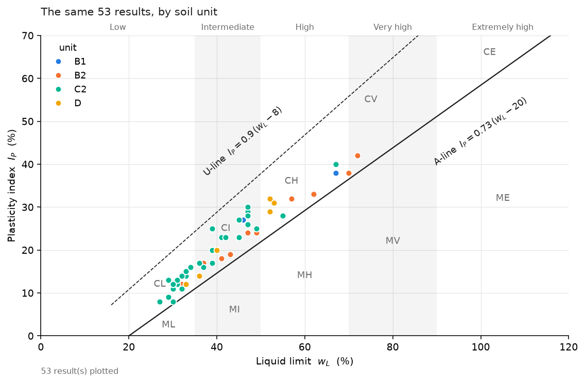

# Post 3: LinkedIn



---

Which stratum did that sample come from?

AGS does not tell you. The lab result knows its borehole and its depth. The stratum knows its top and base. Matching them is a join on a depth range, which is awkward in a spreadsheet and one statement in SQL.

laterite makes every group in the file a SQL table, named by its four-letter code:

```python
import laterite

ags = laterite.read("your_file.ags")
ags.sql("""
    SELECT g.GEOL_STAT AS unit, count(*) AS tests,
           round(avg(l.LLPL_PI), 1) AS mean_pi
    FROM LLPL l
    JOIN GEOL g
      ON g.LOCA_ID   = l.LOCA_ID
     AND l.SAMP_TOP >= g.GEOL_TOP
     AND l.SAMP_TOP <  g.GEOL_BASE
    GROUP BY ALL ORDER BY unit
""")
```

```
unit  tests  mean_pi
B1        2     32.5
B2       12     24.3
C2       33     18.3
D         6     23.0
```

No database to set up and nothing to load. The columns are already typed, so the depth comparison works as written.

Same 53 results as last time, now coloured by the soil unit each one was sampled from.

Full script and the three-table version: [link]

Data: Netherlands Enterprise Agency (RVO) / Fugro.

#AGS4 #geotechnics #python #sql
