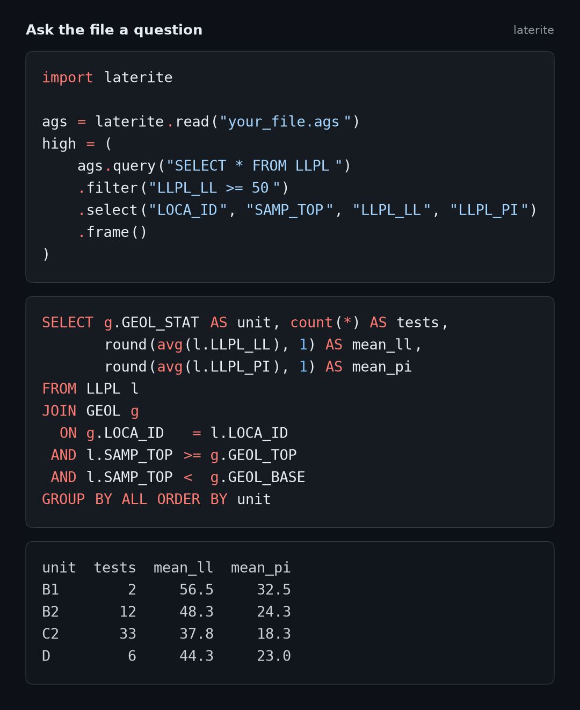

# Post 3: LinkedIn




---

Which of these results are high plasticity?

That is a question about one table, and laterite has its own way to ask it. Say which rows, say which columns:

```python
import laterite

ags = laterite.read("your_file.ags")
high = (
    ags.query("SELECT * FROM LLPL")
    .filter("LLPL_LL >= 50")
    .select("LOCA_ID", "SAMP_TOP", "LLPL_LL", "LLPL_PI")
    .frame()
)
```

Ten of the 53. No casting, because the columns are already numbers.

The next question is harder: which soil unit did each one come from? AGS does not say. The lab result knows its borehole and depth; the stratum knows its top and base. You have to match them.

That is where laterite hands you the full power of SQL. Every group in the file is a table, named by its four-letter code, and you can join them:

```sql
SELECT g.GEOL_STAT AS unit, count(*) AS tests,
       round(avg(l.LLPL_LL), 1) AS mean_ll,
       round(avg(l.LLPL_PI), 1) AS mean_pi
FROM LLPL l
JOIN GEOL g
  ON g.LOCA_ID   = l.LOCA_ID
 AND l.SAMP_TOP >= g.GEOL_TOP
 AND l.SAMP_TOP <  g.GEOL_BASE
GROUP BY ALL ORDER BY unit
```

```
unit  tests  mean_ll  mean_pi
B1        2     56.5     32.5
B2       12     48.3     24.3
C2       33     37.8     18.3
D         6     44.3     23.0
```

If you do not write SQL, that should not stop you. I am not fluent either. This is the kind of thing an LLM is very good at: give it the column names, ask the question in plain words, and it writes the query. The article shows what to paste in, and how to check the answer it gives you: [link]

Data: Netherlands Enterprise Agency (RVO) / Fugro.

#AGS4 #geotechnics #python #sql
