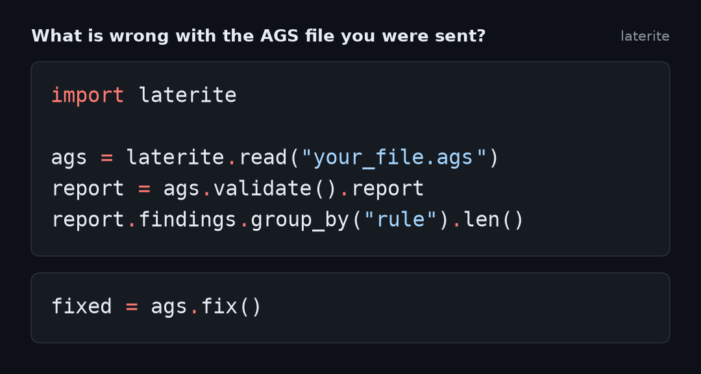
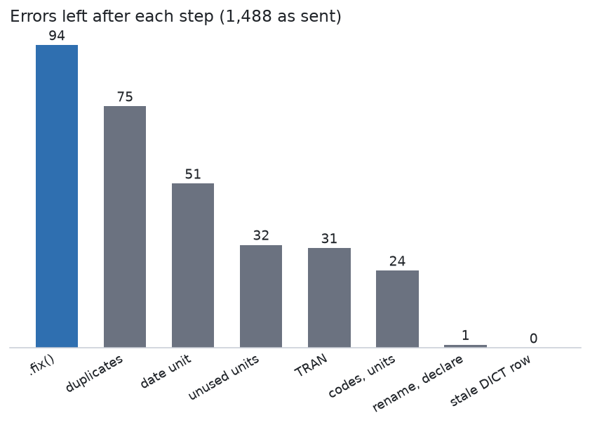
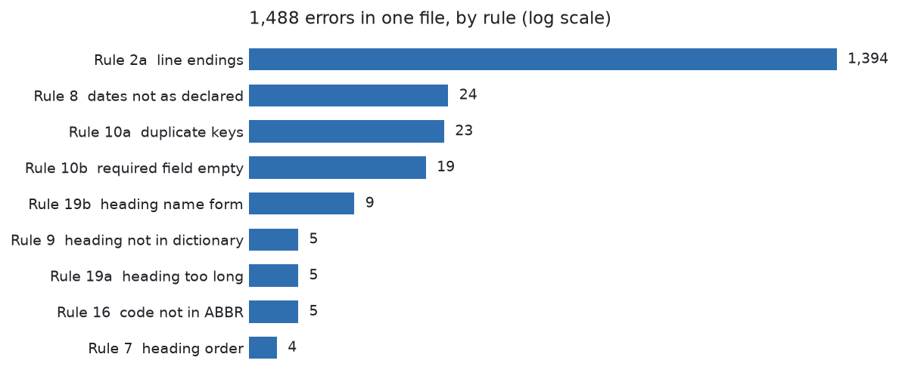

# Post 4: LinkedIn







---

I validated a real AGS file from a public archive. 1,488 errors.

It is not as bad as it looks. The findings come back as a table, so you can count them:

```python
import laterite

ags = laterite.read("your_file.ags")
report = ags.validate().report
report.findings.group_by("rule").len()
```

1,394 of the 1,488 are one thing: line endings.

```python
fixed = ags.fix()
```

94 left. The rest took seven small edits by hand, each one a decision. Then the file validates clean, and not one borehole, stratum or sample value has changed.

All eight steps, and which of them laterite should be doing for you: [link]

Contains British Geological Survey materials ©NERC 2026.

#AGS4 #geotechnics #python #dataquality
