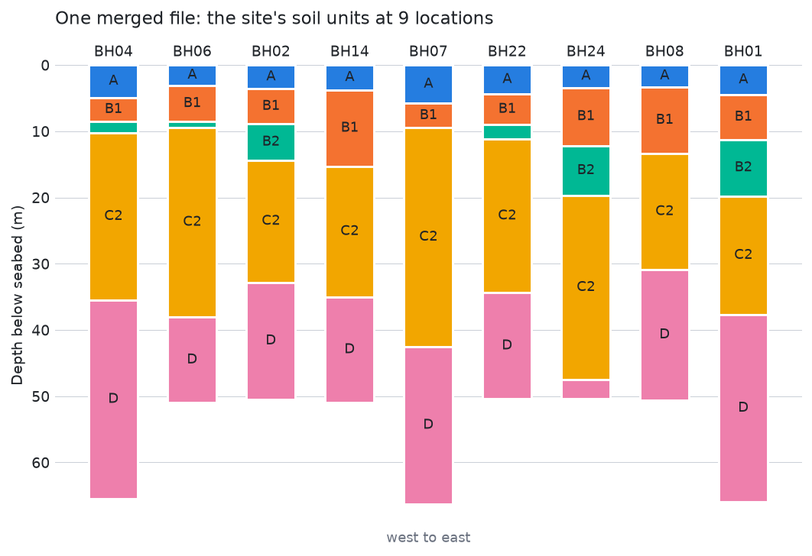

# Seventeen files in, one file out

_Post 5 of 5. Script: `merge_files.py`, beside this draft._



Fugro's borehole campaign for site III of the Hollandse Kust (zuid) wind farm
zone is published as seventeen AGS4 files, one per borehole. That is a
sensible way to issue data and an awkward way to use it. Posts 2 and 3 asked
questions about the whole site: all 53 Atterberg results, every stratum. For
that you want one file.

## Merge

```python
from pathlib import Path

import laterite
from laterite import TranStamp

files = sorted(p for p in Path("folder").iterdir() if p.suffix.lower() == ".ags")

stamp = TranStamp(
    issue="1",
    date="2026-11-28",
    producer="Example Ltd",
    recipient="Example Client",
    status="Final",
    description="All boreholes, merged",
)
result = laterite.merge(*files, tran=stamp)
merged = laterite.read(result.bytes)
```

`merge` takes any number of sources and returns the merged file as bytes,
along with a list of warnings. It does the parts that go wrong by hand: one
set of headings per group, and one UNIT, TYPE, ABBR and DICT table reconciled
from all the inputs. Rows are matched on their KEY headings, not their
position, so a record that arrives in two files is one record in the result.
Where the two disagree, the later file wins, and `result.revisions` lists
every row that happened to.

## Why the stamp

Every AGS4 file has exactly one TRAN row saying who issued it, to whom, and
when. A merged file is a new transmission, and none of the seventeen input
rows describes it. Leave the stamp out and laterite still merges, but it
tells you:

```
no merge TRAN stamp supplied; TRAN was reconciled like any other group …
```

Pass a `TranStamp` and the merged file says what it is: your issue, your
date, your name on it. The warnings list comes back empty.

## Check the counts

```python
for code in ("LOCA", "GEOL", "SAMP"):
    before = sum(f[code].height for f in map(laterite.read, files) if code in f.groups)
    print(f"{code}  {before:>4} in  {merged[code].height:>4} out")
```

```
LOCA    17 in    17 out
GEOL   114 in   114 out
SAMP   754 in   754 out
```

Seventeen boreholes, 114 strata, 754 samples, all present. A lower count
would mean two inputs held a record with the same key and merge kept one:
what you want when a later issue revises an earlier one, and worth knowing
either way.

## What merge does not do

It does not repair. Validate the result:

```python
report = merged.validate().report
print(f"{report.errors} errors, {report.warnings} warnings")
# 17 errors, 3 warnings
```

Seventeen errors, and they are one fault seventeen times: each input has a
single character outside the permitted set in its LOCA row, and each one
came through. Merging gathers what the inputs say. Cleaning is post 4.

It also needs the inputs to agree about types. If one file declares a
heading `2DP` and another `X`, merge stops and says so rather than choosing.
`on_type_clash=` lets you decide. Two files that disagree about a unit always
stop it, because there is no safe way to pick.

## What you can do now

Everything from the earlier posts, across the whole site:

```python
merged.at("LOCA", ["HKZ3-BH04-SA"]).frames()   # post 1
merged["LLPL"]                                  # post 2: all 53 results
merged.sql("SELECT … FROM LLPL l JOIN GEOL g …")  # post 3
```

## The figure

The seventeen boreholes sit at nine locations: most were drilled two or three
times a few metres apart. Drawing all seventeen shows the same ground again
and again, so the figure keeps the deepest hole at each location and orders
them west to east. That choice is one query on the merged file (`figures.py`
has it in full):

```sql
SELECT LOCA_ID,
       row_number() OVER (
           PARTITION BY regexp_extract(LOCA_ID, 'BH([0-9]+)', 1)
           ORDER BY LOCA_FDEP DESC
       ) AS deepest_first
FROM LOCA
```

## No file to hand?

[laterite-quarry](https://github.com/niko86/laterite-quarry) fetches the
seventeen files:

```
uvx --from "laterite-quarry[rvo]" quarry rvo pull hkz-wfs3-bh
```

_Data: Netherlands Enterprise Agency (RVO) / Fugro. Run on laterite 0.17.1._
