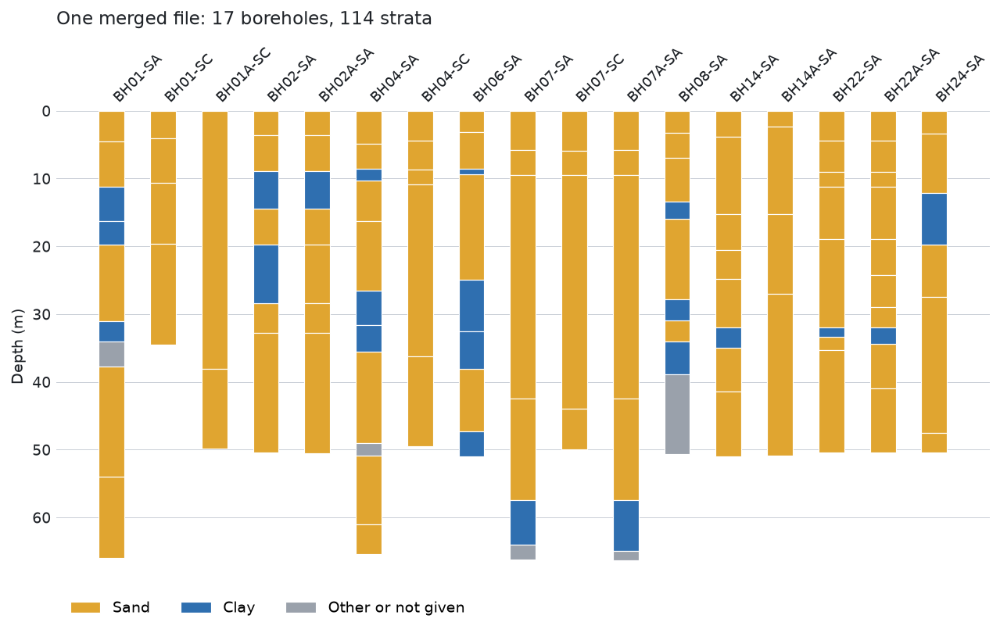

# Post 5: LinkedIn



---

Seventeen boreholes, seventeen AGS files. You want one.

Copying and pasting groups between AGS files is how headings drift, units disagree and a project ends up with three TRAN rows. laterite merges them properly:

```python
import laterite

result = laterite.merge(*files, tran=stamp)
merged = laterite.read(result.bytes)
```

It lines up the headings, reconciles the unit, dictionary and abbreviation tables, and matches rows on their keys. Where two files disagree about a type or a unit it stops and says so, rather than picking one.

Then check it, because a merge you have not checked is a rumour:

```
LOCA    17 in    17 out
GEOL   114 in   114 out
SAMP   754 in   754 out
```

Every row accounted for. The picture is all seventeen boreholes drawn from that one file. From here the whole site is one read: one `.at()` for any hole, one SQL join across all seventeen, one plasticity chart.

That is how the charts in the last two posts were made. The files are Fugro's borehole campaign for the Hollandse Kust (zuid) wind farm zone, published as one AGS file per borehole.

Full script, and what merge does not do for you: [link]

That is the end of this series: read one borehole, trust the types, join the groups, clean a real file, merge a site. All of it is `pip install laterite`.

Data: Netherlands Enterprise Agency (RVO) / Fugro.

#AGS4 #geotechnics #python
