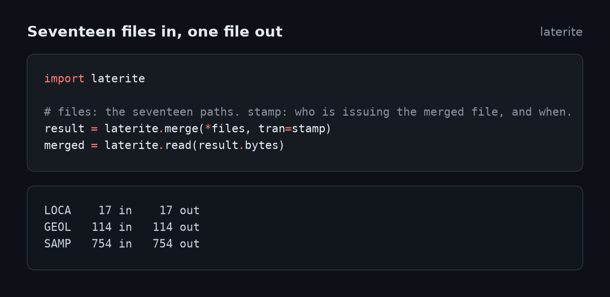

# Post 5: LinkedIn




---

Seventeen boreholes, seventeen AGS files. You want one.

```python
import laterite

# files: the seventeen paths. stamp: who is issuing the merged file, and when.
result = laterite.merge(*files, tran=stamp)
merged = laterite.read(result.bytes)
```

laterite lines up the headings, reconciles the unit and code tables, and matches rows on their keys. Where two files disagree about a type or a unit, it stops and says so.

Then check it, because a merge you have not checked is a rumour:

```
LOCA    17 in    17 out
GEOL   114 in   114 out
SAMP   754 in   754 out
```

Every row accounted for. The picture is the whole site's soil units, drawn from that one file.

The full script, and what merge does not do for you: [link]

That is the week: read one borehole, trust the types, join the groups, clean a real file, merge a site. All of it is `pip install laterite`.

Data: Netherlands Enterprise Agency (RVO) / Fugro.

#AGS4 #geotechnics #python
